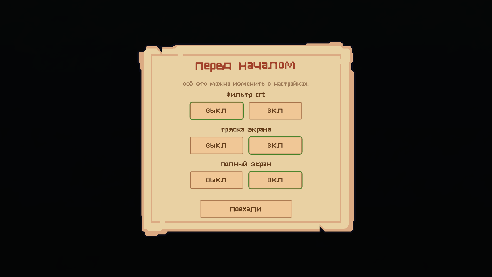

<div align="center">

# 🌲 Русификатор Treeternal

**Неофициальный перевод игры Treeternal на русский язык**

[](https://github.com/DomenicoCano/treeternal-rusifikator/releases/latest/download/ru_patcher.exe)

[Последний релиз](https://github.com/DomenicoCano/treeternal-rusifikator/releases/latest) · Windows 10/11 · Steam



</div>

---

## ⚡ Установка за минуту

1. **Нажмите зелёную кнопку «Скачать» выше** и сохраните `ru_patcher.exe` в постоянную папку (не в «Загрузки»).
2. **Закройте игру** и запустите `ru_patcher.exe`. Он сам найдёт Treeternal в вашей библиотеке Steam(ТАК ЖЕ ПОДХОДИТ ДЛЯ ПЕРЕВОДА ПИРАТКИ).
3. Нажмите **`1`** (Установить) и **Enter**. Готово, запускайте игру.

> Если игру патчер не нашёл, выберите `treeternal.exe` вручную в окне или введите путь в консоли.

### Чтобы перевод не пропадал после обновлений игры (рекомендуется)

Когда Steam обновляет игру, он заменяет `treeternal.exe`, и перевод слетает. Один раз пропишите патчер в параметры запуска, и дальше всё будет происходить само:

1. Steam → Библиотека → правый клик на **Treeternal** → **Свойства** → **Общие** → **Параметры запуска**.
2. Вставьте (путь замените на свой):

```
"D:\Games\ru_patcher.exe" %command%
```

При каждом запуске патчер проверит игру, при необходимости поставит перевод заново (около секунды) и запустит игру. Если после обновления в игре появятся новые строки, которых ещё нет в переводе, они будут на английском, и игра не сломается.

### Как удалить перевод

Запустите `ru_patcher.exe` и нажмите **`2`** (Удалить). Либо в Steam: Свойства → Установленные файлы → **Проверить целостность файлов**. Если вы прописывали патчер в параметры запуска, не забудьте убрать их.

---

## О проекте

Переведены все тексты игры: меню, настройки, карточки, навыки, задания, подсказки, статуя, вознесение, сундуки и так далее (504 строки). Для русских букв добавлены новые глифы во все три шрифта игры в том же пиксельном стиле.

| | |
|---|---|
| Игра | [Treeternal](https://store.steampowered.com/app/4399780/) (Steam) |
| Проверено на | демо-версии (AppID 4399780) |
| Платформа | Windows 10/11, 64-бит |
| Язык интерфейса | весь текст строчными буквами, как в оригинале |

> ⚠️ Проект неофициальный и не связан с разработчиками игры. Для работы нужна установленная копия игры. Файлы игры в этом репозитории **не** распространяются: патчер изменяет только то, что уже лежит у вас на диске, и перед этим сохраняет оригинал рядом как `treeternal.exe.orig`.

### Известные ограничения

- Перевод проверен на демо-версии. На полной версии он должен работать, если формат файлов не изменится, но это пока не проверено.
- Интерфейс игры рассчитан на английский текст. Некоторые длинные русские строки могут выходить за рамки кнопок. Если нашли такие, создайте [Issue](https://github.com/DomenicoCano/treeternal-rusifikator/issues) со скриншотом, и строку сократят.
- После обновления игры без параметра запуска из раздела выше патчер нужно запускать заново.
- Антивирус или Windows SmartScreen могут ругаться на неподписанный exe, собранный PyInstaller. Исходный код лежит здесь же, его можно проверить и собрать самому.

---

## Как это работает

Игра хранит все ресурсы (тексты, шрифты, картинки) в зашифрованном архиве внутри `treeternal.exe`. Патчер при каждой установке:

1. читает архив из **текущей** версии игры, поэтому работает и после обновлений;
2. берёт английские тексты и подставляет русские по ключам из [`data/ru.json`](data/ru.json). Строки, которых нет в переводе, остаются английскими;
3. добавляет кириллицу в три шрифта (`m6x11`, `m6x11plus`, `y2k`);
4. записывает новый архив в отдельную секцию exe и сохраняет оригинал как `treeternal.exe.orig`.

Движок игры рисует только символы с кодами ниже 128, поэтому русские буквы закодированы неиспользуемыми управляющими символами, а в шрифты положены соответствующие глифы. Из-за этого перевод целиком строчный.

Если разработчики изменят формат архива или ключ шифрования, патчер выдаст сообщение «версия не поддерживается» и **не будет менять** игру.

## Сборка из исходников

Нужны Python 3.10.1+ (на 3.10.0 PyInstaller падает из-за ошибки в самом Python, берите, например, 3.12), `numpy`, `pillow` и `pyinstaller`:

```
pip install -r requirements.txt
build.bat
```

Готовый файл появится в `dist\ru_patcher.exe`. Запуск без сборки: `python ru_patcher.py "путь\к\treeternal.exe"`.

## Помочь с переводом

Весь перевод лежит в [`data/ru.json`](data/ru.json): ключ и русская строка. Правила:

- все буквы строчные (прописные кириллические глифов не имеют);
- плейсхолдеры `{}`, `{:.0f}`, `{:g}` и теги `[w]...[/w]`, `[s"t1"]`, `[e]`, `[1]` менять нельзя, их количество должно совпадать с английским оригиналом;
- чем короче строка, тем лучше она поместится в интерфейс.

Правки присылайте через Pull Request.

## Лицензии

- Код патчера: [MIT](LICENSE).
- Текст перевода (`data/ru.json`): CC0.
- Кириллические глифы (`data/strip_*.png`) построены на шрифте [Pixelify Sans](https://github.com/eifetx/Pixelify-Sans) (SIL Open Font License 1.1), см. [THIRD_PARTY.md](THIRD_PARTY.md).
- Treeternal и все материалы игры принадлежат их правообладателям.
